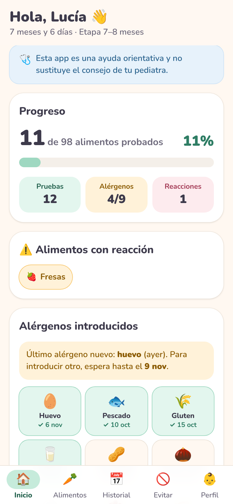
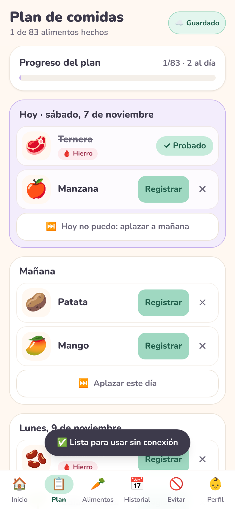
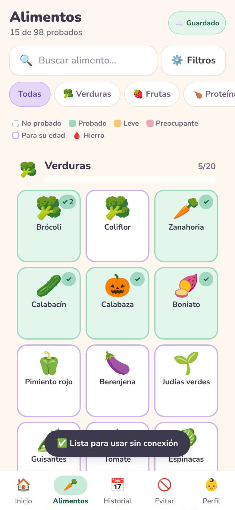
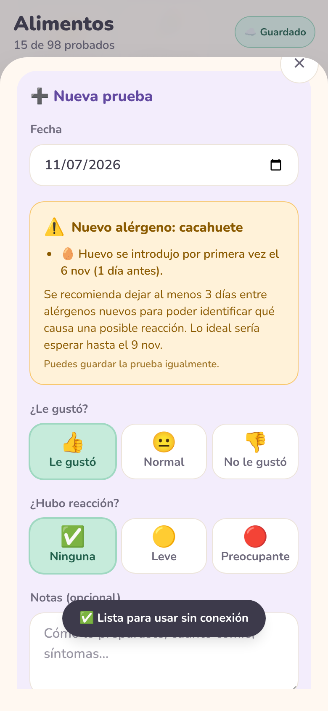

# 🥑 Bocaditos BLW

Mini app web móvil (PWA) para hacer el seguimiento de la **alimentación complementaria con el método BLW** (Baby-Led Weaning) a partir de los 6 meses.

Los datos se guardan en una **base de datos SQLite en tu propio servidor** (por ejemplo, tu NAS) y se comparten entre todos los dispositivos de casa. La app se instala en el móvil y **sigue funcionando sin conexión**: los cambios se envían solos al servidor cuando vuelve la red.

> ⚠️ Esta app es una ayuda orientativa y no sustituye el consejo de tu pediatra.

<p align="center">
  
  
  
  
</p>

## Funcionalidades

- **Catálogo de ~100 alimentos** en 7 categorías, con emoji, edad mínima orientativa (6, 7–8 o 9+ meses), consejo de preparación para BLW (y otro para cuando ya hace la pinza), alérgenos y si es rico en hierro 🩸.
- **Plan de comidas**: 1 o 2 alimentos nuevos al día, con los alérgenos solos y separados, respetando su edad. Si un día no se puede, se **aplaza** y el resto del plan se mueve.
- **Volver a probar** 🔁: marca un alimento como probado pero pendiente de repetir (no le gustó, apenas comió…). Aparece en una lista en el inicio hasta que se lo vuelvas a ofrecer.
- **Registro de pruebas**: fecha, si le gustó (👍 / 😐 / 👎), reacción (ninguna / leve / preocupante) y notas. Se pueden editar y borrar.
- **Estado visual** de cada alimento y **barras de progreso** global y por categoría.
- **Control de alérgenos**: aviso (no bloqueante) si introduces un alérgeno nuevo a menos de 3 días de otro.
- **Sección «Evitar»**: alimentos a evitar antes del año, riesgo de atragantamiento y consejos de seguridad.
- **Perfil del bebé**: calcula su edad y resalta los alimentos adecuados.
- **Buscador y filtros**, **historial** cronológico y **copia de seguridad** en JSON (exportar / importar / borrar todo).
- **Base de datos SQLite** en el servidor, **sincronizada entre dispositivos**, con indicador de estado (☁️ Guardado · ⏳ Pendiente · 📴 Sin conexión).
- **PWA** instalable y usable sin conexión.

## Plan de comidas

En la pestaña **Plan** (y en la tarjeta «Plan de hoy» del inicio):

1. **Crea el plan** eligiendo **1 o 2 alimentos nuevos al día** y la fecha de inicio. Se planifican todos los alimentos que aún no ha probado:
   - primero los recomendados para empezar (ricos en hierro, verduras y frutas), y después el resto alternando categorías;
   - **cada alérgeno nuevo va solo ese día** y con **al menos 3 días** de separación de otro alérgeno nuevo (incluidos los que ya hayas introducido);
   - cada alimento aparece cuando el bebé tiene la **edad mínima** (las uvas, por ejemplo, a partir de los 9 meses). Si aún no tiene 6 meses, el plan empieza cuando los cumpla.
2. **Registra** cada alimento desde el plan: se abre la ficha con el formulario listo. Cualquier prueba de ese alimento, hecha desde donde sea, lo marca como hecho.
3. **¿Hoy no se puede?** Pulsa **«Hoy no puedo: aplazar a mañana»**. Los alimentos pendientes de ese día pasan al siguiente y **todo el plan se mueve un día**, así se mantiene la separación entre alérgenos. También puedes aplazar un día futuro.
4. **¿Te has saltado varios días?** Aparece un aviso con **«Empezar lo pendiente hoy»**, que mueve todo lo pendiente para que continúe desde hoy.
5. Puedes **quitar** un alimento del plan (✕), **rehacerlo** desde hoy (por ejemplo, para pasar de 2 a 1 al día) o **borrarlo**. Las pruebas registradas nunca se borran.

Si un alérgeno del plan coincide con otro introducido hace menos de 3 días (por ejemplo, porque lo diste fuera del plan), el plan te avisa para que lo aplaces.

El orden de los primeros alimentos se puede cambiar en **`src/data/plan.ts`**.

## Volver a probar

Muchos alimentos necesitan varias exposiciones antes de que el bebé los acepte. Para no olvidar repetirlos:

- Al **registrar una prueba**, activa **🔁 Volver a probar**. Se activa solo si eliges 👎 «No le gustó», y puedes desactivarlo.
- Desde la **ficha de un alimento** ya probado puedes **marcarlo para volver a probar** (o quitar la marca) sin registrar una prueba nueva.
- El alimento **cuenta como probado** para el progreso y el plan, pero se ve en azul con 🔁. Aparece en la lista **«Para volver a probar»** del inicio y del plan, empezando por el que hace más tiempo que no prueba, con un botón para registrarlo.
- Cuando registras una prueba nueva **sin** la marca, deja de estar pendiente. En *Alimentos → Filtros → 🔁 Volver a probar* ves todos los pendientes.

## Cómo funciona

```
 Móvil / PC (navegador)                    Servidor (Docker en tu PC o NAS)
┌──────────────────────────┐   /api/sync   ┌──────────────────────────────────┐
│ App React (PWA)          │ ────────────▶ │ Node + Hono                      │
│ · caché local + cola de  │ ◀──────────── │ · sirve la app                   │
│   cambios sin conexión   │  estado total │ · SQLite (node:sqlite) en /data  │
└──────────────────────────┘               └──────────────────────────────────┘
```

- Cada cambio se aplica al instante en pantalla y se guarda en una **cola local**. La app la envía al servidor en cuanto puede: al momento, al recuperar la conexión, al volver a la app y cada minuto.
- El servidor aplica los cambios en una **transacción SQLite**, sin repetir los que ya recibió, y devuelve el estado completo.
- Si una prueba se borró en un dispositivo, otro que estaba sin conexión no la «resucita».
- Si ya usabas la versión anterior (datos solo en el navegador), la primera vez esos datos **se suben solos** al servidor.

## Probarlo en tu PC

### Opción A: con Docker (igual que en el NAS)

Necesitas **Docker Desktop** abierto. Sin archivo `.env`, se usan los valores para probar: datos de ejemplo y base de datos en un volumen de Docker.

```bash
git clone https://github.com/beniseti/mini-blw.git
```
```bash
cd mini-blw
```
```bash
docker compose up -d --build
```

Abre **http://localhost:8080**. La primera vez que arranca, el servidor **crea la base de datos y la rellena con datos de ejemplo**: un bebé «Lucía (demo)» de 7 meses y unas 17 pruebas con fechas recientes. Puedes verlo en los logs:

```bash
docker compose logs bocaditos
```
```
🆕 Base de datos creada en /data/bocaditos.db (esquema v2)
🧪 Rellenada con datos de ejemplo (SEED_DEMO_DATA=true)
🥑 Bocaditos BLW escuchando en http://localhost:8080
```

- **Parar** (los datos se conservan):

```bash
docker compose down
```

- **Empezar de cero con datos de ejemplo nuevos.** La opción `-v` borra el volumen con la base de datos:

```bash
docker compose down -v
```
```bash
docker compose up -d
```

Para probar la sincronización, abre la app en dos navegadores (o en el PC y en el móvil, con `http://IP-de-tu-PC:8080`): lo que registres en uno aparece en el otro.

### Opción B: con Node.js (para modificar el código)

Necesitas **Node.js 22.13 o superior** (recomendado: la versión LTS de https://nodejs.org).

```bash
npm install
```
```bash
npm run dev
```

Abre **http://localhost:5173**. Esto arranca dos cosas a la vez:

- **La app con Vite**, con recarga en caliente.
- **El servidor API** en el puerto 8787. Crea `data/bocaditos.db` con datos de ejemplo la primera vez y se reinicia solo al editar `server/`.

Para empezar de cero, borra la carpeta `data/`.

Para probar la versión compilada (igual que en producción, en http://localhost:8080):

```bash
npm run build
```
```bash
npm run start:demo
```

| Comando              | Qué hace                                                                   |
| -------------------- | -------------------------------------------------------------------------- |
| `npm run dev`        | App (Vite) + servidor API con base de datos de ejemplo                     |
| `npm test`           | Tests (servidor, base de datos, sincronización, alérgenos, edad, catálogo…) |
| `npm run lint`       | Linter (oxlint)                                                            |
| `npm run build`      | Comprueba tipos y compila la app (`dist/`) y el servidor (`dist-server/`)  |
| `npm start`          | Arranca la versión compilada (base de datos vacía si es nueva)             |
| `npm run start:demo` | Igual, pero con datos de ejemplo si la base de datos es nueva              |

## Desplegar en el NAS (Docker)

> 🔒 **La app no tiene contraseña**: cualquiera que llegue a la URL puede ver y modificar los datos. Úsala **solo dentro de tu red de casa o a través de una VPN** (Tailscale, WireGuard, la VPN del NAS…). **No abras el puerto a Internet** ni la publiques con un proxy inverso abierto al exterior.

Estos pasos sirven para cualquier NAS con Docker y acceso SSH (UGREEN, Synology, QNAP…). Los ejemplos usan la carpeta compartida `docker` del volumen 1 (`/volume1/docker`); cámbiala por la tuya.

**1. Activa SSH en el NAS y conéctate** desde la terminal de tu PC (en UGREEN: *Panel de control → Terminal → SSH*):

```bash
ssh tu-usuario@IP-del-NAS
```

**2. Descarga el proyecto desde GitHub:**

```bash
cd /volume1/docker
```
```bash
sudo git clone https://github.com/beniseti/mini-blw.git bocaditos
```

Si el NAS dice `git: command not found`, usa Git desde Docker (hace lo mismo):

```bash
sudo docker run --rm -v /volume1/docker:/git -w /git alpine/git clone https://github.com/beniseti/mini-blw.git bocaditos
```

**3. Crea la configuración y la carpeta de la base de datos:**

```bash
cd bocaditos
```
```bash
sudo cp .env.example .env
```
```bash
sudo mkdir -p data && sudo chown -R 1000:1000 data
```

El `.env` ya viene listo para uso real: base de datos **vacía** (`SEED_DEMO_DATA=false`), guardada en la carpeta `data`, y puerto **8080**. Para usar otro puerto, por ejemplo el 8095:

```bash
sudo sed -i 's/^PORT=.*/PORT=8095/' .env
```

**4. Compila y arranca.** La primera vez tarda unos minutos:

```bash
sudo docker compose up -d --build
```

Si tu NAS solo tiene la versión antigua del comando, usa `sudo docker-compose up -d --build`.

**5. Comprueba que está en marcha:**

```bash
sudo docker compose logs bocaditos
```

Debe mostrar `🆕 Base de datos creada en /data/bocaditos.db` y `🥑 Bocaditos BLW escuchando…`. Abre **http://IP-del-NAS:8080** en el navegador. El contenedor también aparece en la app Docker del NAS, desde donde puedes pararlo o ver sus registros.

**Actualizar a una versión nueva.** El `.env` y la carpeta `data` no se tocan:

```bash
cd /volume1/docker/bocaditos
```
```bash
sudo git pull
```
```bash
sudo docker compose up -d --build
```

Sin `git` en el NAS, el `pull` se hace así:

```bash
sudo docker run --rm -v /volume1/docker/bocaditos:/git -w /git alpine/git pull
```

### HTTPS: para instalarla en el móvil y usarla sin conexión

Por `http://IP-del-NAS:8080` la app funciona y sincroniza, pero los navegadores **solo permiten instalar la PWA y usar el modo sin conexión con HTTPS**. Opciones:

- **Synology:** *Panel de control → Portal de inicio de sesión → Avanzado → Proxy inverso*. Crea una regla de `https://bocaditos.tu-dominio` a `http://localhost:8080` y asígnale un certificado de Let's Encrypt (*Seguridad → Certificado*). Si es para usarla solo en casa, no abras ese puerto en el router.
- **Tailscale:** con `tailscale serve` obtienes HTTPS dentro de tu red privada, sin abrir puertos.
- **Caddy incluido en el compose** (necesita un dominio que apunte al NAS):

```bash
DOMAIN=bocaditos.midominio.com docker compose --profile https up -d --build
```

### Configuración (`.env`)

Se configura con un archivo `.env` junto a `docker-compose.yml` (copia de `.env.example`). No se sube a Git, así que `git pull` nunca lo pisa. Sin `.env` se usan los valores para probar en el PC.

| Variable         | En `.env.example` | Sin `.env`        | Descripción                                                         |
| ---------------- | ----------------- | ----------------- | ------------------------------------------------------------------- |
| `PORT`           | `8080`            | `8080`            | Puerto en el que se abre la app                                     |
| `SEED_DEMO_DATA` | `false`           | `true`            | Datos de ejemplo **solo al crear** la base de datos                 |
| `DATA_PATH`      | `./data`          | `bocaditos_data`  | Dónde se guarda la base de datos: carpeta del NAS o volumen Docker  |
| `TZ`             | `Europe/Madrid`   | `Europe/Madrid`   | Zona horaria                                                        |

Si cambias `.env`, aplica los cambios con `docker compose up -d`.

## La base de datos

- Es un único archivo, **`bocaditos.db`**. En el NAS, con el `.env` de ejemplo, está en la carpeta `data` del proyecto (por ejemplo `/volume1/docker/bocaditos/data/bocaditos.db`). Sin `.env`, está en el volumen Docker `bocaditos_data`. Sobrevive a reinicios y actualizaciones del contenedor.
- **Se crea sola** la primera vez que arranca el servidor. Las tablas se crean y actualizan con migraciones versionadas (`server/db.ts`), así que futuras versiones pueden cambiar el esquema sin perder datos.
- Tablas: `profile` (el bebé), `trials` (las pruebas), `plan_items` (el plan de comidas), `deleted_trials` (borrados, para la sincronización), `applied_ops` (cambios ya recibidos) y `meta`.
- Al actualizar a una versión con cambios en el esquema (por ejemplo, la que añadió el plan de comidas), la base de datos existente **se migra sola** al arrancar, sin perder datos.
- Usa el SQLite integrado en Node (`node:sqlite`): no hay dependencias nativas que compilar, así que funciona igual en NAS con procesador Intel/AMD o ARM.

### Copias de seguridad

- **Desde la app:** *Perfil → Exportar datos (JSON)*. Para restaurar, *Importar copia*.
- **El archivo de la base de datos.** Con `DATA_PATH=./data`, que es lo recomendado en el NAS, basta con incluir la carpeta `data` en las copias de seguridad del NAS. Para una copia manual coherente, para antes el contenedor:

```bash
sudo docker compose stop
```
```bash
sudo cp data/bocaditos.db bocaditos-copia.db
```
```bash
sudo docker compose start
```

- **Si al arrancar sale** `❌ No se puede abrir ni crear la base de datos`, el contenedor (usuario 1000) no puede escribir en la carpeta `data`. Ejecuta `sudo chown -R 1000:1000 data` en la carpeta del proyecto y vuelve a arrancar.

## Editar el catálogo de alimentos

Todo el catálogo está en **`src/data/foods.ts`** (el catálogo no se guarda en la base de datos: solo las pruebas). Cada alimento es un objeto así:

```ts
{
  id: 'platano',                 // único, en minúsculas; no lo cambies si ya hay pruebas guardadas
  name: 'Plátano',
  emoji: '🍌',
  category: 'frutas',            // verduras | frutas | proteinas | cereales | lacteos | grasas | hierbas
  minAge: 6,                     // 6 (6 m), 7 (7–8 m) o 9 (9+ m)
  prep: 'Maduro, por la mitad con parte de la piel como mango…',
  prep9m: 'Rodajas o trocitos.', // opcional: cuando ya hace la pinza
  allergens: ['gluten'],         // opcional: huevo | pescado | gluten | lacteos | cacahuete | frutos_secos | sesamo | soja | marisco
  iron: true,                    // opcional: rico en hierro
  note: '…',                     // opcional: advertencia
}
```

Otros datos editables:

- `src/data/plan.ts`: orden de los primeros alimentos del plan de comidas.
- `src/data/avoid.ts`: listas de la sección «Evitar» y consejos de seguridad.
- `src/data/categories.ts`: categorías y sus colores pastel.
- `src/data/allergens.ts`: alérgenos y días de espera (`ALLERGEN_WAIT_DAYS = 3`).
- `server/demo.ts`: datos de ejemplo.

Después de editar, ejecuta `npm test`: un test comprueba que el catálogo sigue siendo coherente. Para aplicar los cambios en Docker: `docker compose up -d --build`.

## Estructura del proyecto

```
├─ Dockerfile, docker-compose.yml, deploy/Caddyfile
├─ server/                 servidor Node: API (app.ts), SQLite (db.ts), datos de ejemplo (demo.ts)
├─ scripts/dev.mjs         arranca app + API en desarrollo
├─ public/                 iconos de la PWA
└─ src/
   ├─ data/                catálogo editable (foods.ts), categorías, alérgenos, «Evitar»
   ├─ shared/              validación común a la app y al servidor
   ├─ lib/                 lógica pura y testeada: plan de comidas, edad, progreso, alérgenos, operaciones, fechas
   ├─ store/               estado global, caché local, cola de sincronización y cliente de la API
   ├─ hooks/               enrutado por hash, instalación de la PWA
   ├─ components/          ui/, layout/, foods/, trials/, progress/, plan/
   └─ pages/               Inicio, Plan, Alimentos, Ficha, Historial, Evitar, Perfil
```

## Fuentes

Los consejos se han redactado a partir de recomendaciones generales de alimentación complementaria y seguridad en BLW (Asociación Española de Pediatría, AESAN y guías divulgativas de BLW). Las edades son orientativas: cada bebé tiene su ritmo. Ante cualquier duda o reacción, consulta con tu pediatra. En una emergencia, llama al **112**.
